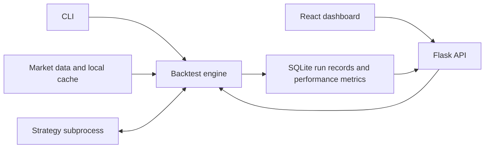

# getAlpha

**getAlpha (getABG)** is a quantitative backtesting platform for researching equity strategies. It combines a Python simulation engine, a Flask API and a React dashboard for configuring runs and inspecting performance.

[Web app](https://get-abg.vercel.app) · [CLI entry point](run_backtest.py) · [Backtest engine](engine/backtest.py) · [Dashboard](dashboard/src/Dashboard.jsx)

## What it does

- Runs built-in and custom Python strategies over historical market data.
- Combines vectorized screening with event-driven simulation.
- Tracks run state, execution events, portfolio snapshots and trade results.
- Reports strategy performance through a CLI, API and charting interface.
- Provides account authentication, run-status monitoring and strategy subprocess timeouts.

## System overview



## Start here

| Component | Responsibility |
|---|---|
| [engine/backtest.py](engine/backtest.py) | Backtest orchestration and simulated execution |
| [data/ingestion.py](data/ingestion.py) | Market-data fetching and Parquet/CSV caching |
| [sandbox/worker.py](sandbox/worker.py) | Strategy subprocess execution |
| [database/state_db.py](database/state_db.py) | Persistent run and portfolio records |
| [metrics/performance.py](metrics/performance.py) | Performance reporting |
| [api/server.py](api/server.py) | API, authentication integration and run management |
| [dashboard/src](dashboard/src) | React application |
| [strategies](strategies) | Built-in strategy examples |

## Run a backtest

Install Python dependencies in your preferred virtual environment:

```bash
git clone https://github.com/arushg05/getABG.git
cd getABG
python -m pip install -r requirements.txt
python run_backtest.py --strategy ma_crossover --tickers AAPL MSFT --start 2022-01-01 --end 2023-12-31 --capital 100000 --output report.json
```

The CLI writes its report to `report.json`. Market-data requests may require network access when a suitable local cache is unavailable. US symbols use their normal ticker; Indian symbols use Yahoo-style exchange suffixes such as `RELIANCE.NS`.

For available arguments:

```bash
python run_backtest.py --help
```

## Run the dashboard

The API requires an `AUTH_SECRET`. Create a local `.env` file at the repository root with a strong, randomly generated secret:

```dotenv
AUTH_SECRET=replace-with-a-long-random-local-secret
```

Start the API from the repository root:

```bash
python api/server.py
```

In a second terminal, use a Node.js version compatible with the dashboard's Vite tooling:

```bash
cd dashboard
npm install
npm run dev
```

Open the address printed by Vite, normally **http://localhost:5173**. The development configuration proxies `/api` requests to **http://localhost:5050**. Account verification, payments and AI strategy generation have additional service/configuration requirements; the CLI is the simplest starting point for inspecting the backtesting engine.

## Strategy contract

Strategies define a `Strategy` class with `on_tick(timestamp, market_state, portfolio_state)` returning order dictionaries. See [ma_crossover.py](strategies/ma_crossover.py) for a complete example rather than starting from an empty template.

## Design choices

- **Separate engine and interface:** the CLI provides a direct way to inspect research runs; the dashboard adds account and run-management workflows.
- **Persistent research records:** SQLite stores run state, execution events and portfolio snapshots, rather than relying only on a final performance chart.
- **Two-pass simulation:** vectorized screening narrows candidate periods before event-driven strategy evaluation. Its benefit depends on the workload; no universal speedup is claimed.
- **Subprocess execution:** custom strategies run through a worker with timeout handling. Process separation is a control, not a complete security boundary for arbitrary untrusted code.
- **Cached market data:** ingestion prefers a suitable local cache and uses external requests when required. Data source, price adjustments and availability assumptions matter to the interpretation of a backtest.

## Existing verification material

The repository contains [authentication checks](test_auth.py), [rolling-metric checks](test_rolling_metrics.py) and [run-comparison checks](test_run_comparison.py). Read their setup before running them: account/API checks may need the local services and configuration. Their presence is not evidence that every strategy or deployment has been validated.

A meaningful review starts with a small fixed strategy and dataset, inspects orders and portfolio records, and checks the report against those records. Compare costs, fill timing, strategy data access and missing-bar behavior before treating a favorable curve as an investment result.

## Scope

This is a research and backtesting platform, not a live brokerage execution service. Simulated results depend on data quality, execution assumptions and strategy design. Subprocess timeouts are implemented controls, not a claim of complete isolation for untrusted code.

**Stack:** Python, Flask, React, SQLite, Pandas, NumPy, PyArrow, Recharts.
